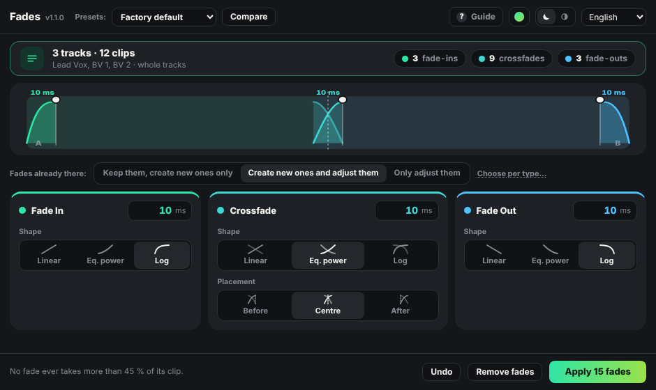
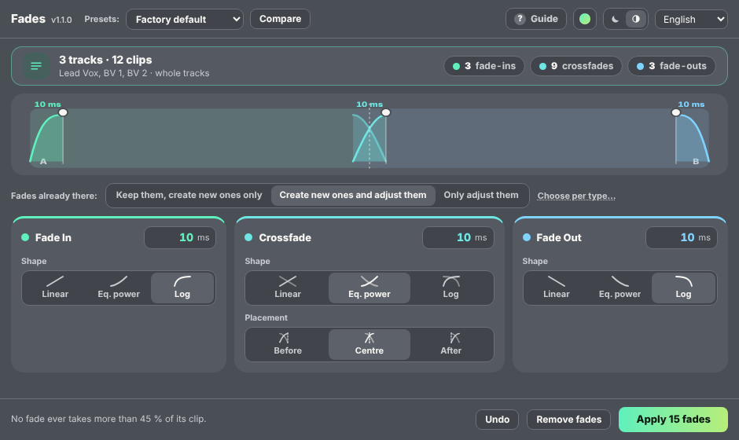

# Fades for LUNA

Batch fades for LUNA. Put fade-ins, fade-outs and crossfades on every clip in the selection at
once: clips that touch get a crossfade, free edges get a fade-in or a fade-out. Set the lengths by
dragging them on the strip or typing them, pick the shapes, choose whether to create new fades or
adjust the ones already there, and keep your settings as presets. Perfect after LUNA's Strip
Silence, or for a whole edited vocal or drum track.

  
  

## Features

- **Every clip at once:** all audio clips of the selected tracks within the selection, or the
  whole tracks when there is no range.
- **The right fade in each place:** a crossfade where two clips touch, a fade-in or fade-out on
  free edges. No fade ever takes more than 45 % of a clip.
- **Drag the lengths** on the strip, where both clips are drawn with every fade to scale, or type
  them in milliseconds (↑ ↓ for 1 ms, Shift for 10 ms).
- **Three shapes** per fade (linear, equal power, log) and **crossfade placement** before,
  centred on or after the cut.
- **Create or adjust:** for each kind of fade choose whether to create new ones, change the shape
  of existing ones, change their length, or any mix, so fades you made by hand can stay as they are.
- **Presets:** Vocal, Drums, Dialog, Soft and Minimal, plus your own — save, overwrite and delete
  them from the menu — and **Compare** to switch between your changes and the loaded preset.
- **See it before you apply it:** the selection and how many fade-ins, crossfades and fade-outs
  Apply will make are shown at the top, and on the button.
- **One choice for fades already there:** keep them and only create new ones, create and adjust,
  or only adjust; or choose per type.
- **Remove fades** from the selection, and **Undo** the last run in one go.
- **Dark and grey themes, seven colours.**
- **7 languages:** English, Español, Català, Français, Deutsch, Italiano and Português.

## How to use it

1. In LUNA, select one or more audio tracks and, if you like, a range.
2. In **Fades**, pick a preset or set the lengths, shapes and what to apply to.
3. Press **Apply**. The bar at the bottom tells you how many fade-ins, crossfades and fade-outs
   were made.

The first time it opens, it asks for your language and then a short guide walks you through the
window in it; the **Guide** button brings it back whenever you need it.

## Support

If something does not work as expected, Alt-click the version number at the top of the window:
it copies a short report to paste in a message to fedetrillo@gmail.com.

## Install

Requires LUNA 3.1.2 or later. Install it from LUNA's Add On marketplace, or download
`fades.lunaaddon` from the latest release and double-click it. Then open a session and choose
**Add Ons > Windows > Fades**.

## En español

Fundidos en bloque para LUNA: entradas, salidas y fundidos cruzados en todos los clips de la
selección a la vez. Los clips que se tocan reciben un cruzado y los bordes libres, una entrada o
una salida. Ajusta las duraciones arrastrándolas o escribiéndolas, elige la forma y la colocación
del cruzado, decide si crear fundidos nuevos o ajustar los que ya hay, y guarda tus presets.
Ideal después del Strip Silence de LUNA. Modo oscuro y gris, 7 idiomas.

## Licence

Copyright (c) 2026 Fede Trillo. All rights reserved. Free to install and use in LUNA; the code
may not be copied, modified or redistributed. See [LICENSE](LICENSE). The bundled LUNA Builder
SDK is Universal Audio's, under the Apache License 2.0: see
[THIRD_PARTY_NOTICES.md](THIRD_PARTY_NOTICES.md).

Contact: fedetrillo@gmail.com
